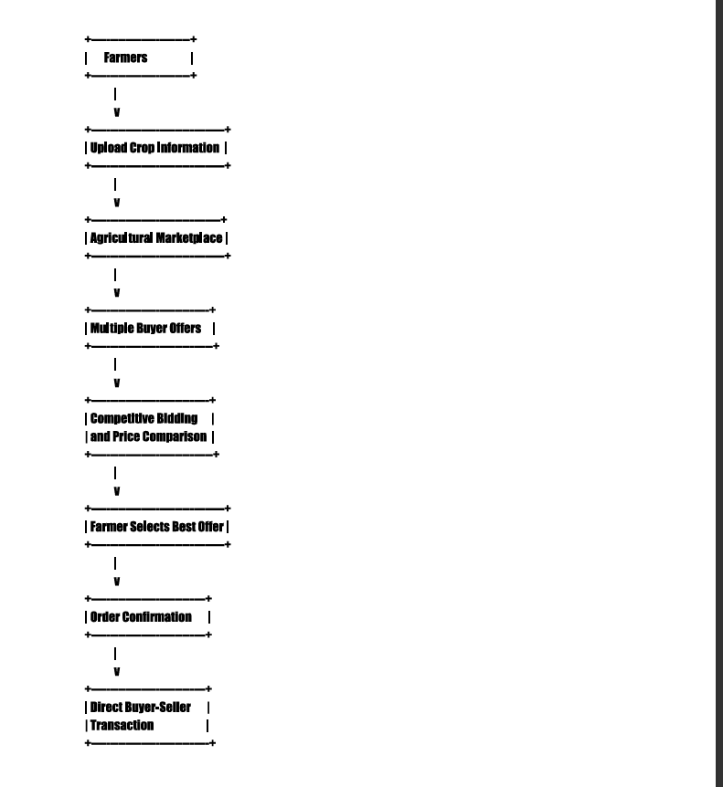

# Smart India Hackathon Workshop
# Date:24/11/2026
## Reference Number:26013893
## Name:Jhanani K

## Problem Title
SIH 26033: Multiple intermediaries reduce farmers earnings and increase consumer prices.

## Problem Creater's Organization
Ministry of Consumer Affairs, Food & Public Distribution

## Theme
Agriculture, FoodTech & Rural Development

## Problem Description
Expected Solution: Create a digital marketplace that:

• Connects farmers/FPOs directly with consumers and bulk buyers.
• Provides logistics support.
• Uses AI for demand forecasting and route optimization.

Benefits:

• Better prices for farmers.
• Lower prices for consumers.
• Reduced supply chain inefficiencies.

## Proposed Solution
 FarmConnect SmartAgri Network

1. Detailed Explanation

FarmConnect SmartAgri Network is a digital agricultural marketplace designed to help farmers receive better prices for their agricultural products through a transparent online bidding system.

The platform connects farmers directly with wholesalers, retailers, supermarkets, hotels and other buyers.

Farmers can upload details about their available products, including crop type, quantity, quality, location and expected price. Registered buyers can view these products and submit competitive price offers.

Instead of depending on multiple intermediaries, farmers can compare different offers and select the most suitable buyer.

The platform also provides price comparison, digital transaction records and order tracking to improve transparency and trust between farmers and buyers.

2. How It Addresses the Problem

- Connects farmers directly with multiple buyers.
- Introduces a transparent online bidding system.
- Allows farmers to compare different purchase offers.
- Displays market price information for agricultural products.
- Reduces dependency on unnecessary intermediaries.
- Provides digital order confirmation and tracking.
- Helps farmers make informed selling decisions.

3. Innovation and Uniqueness

The main innovation of FarmConnect is its Multi-Buyer Competitive Bidding System.

For example, a farmer has 500 kg of onions available for sale.

Instead of selling the entire quantity to one intermediary, the farmer can publish the product on the platform. Different buyers can submit their price offers.

The farmer can compare the offers and choose the buyer based on price, quantity and delivery requirements.

Additional Innovative Features

1. Smart Price Comparison: Compares buyer offers with available market price information.
2. Quality-Based Product Listing: Allows farmers to upload product quality details and photographs.
3. Buyer Verification: Helps build trust through verified buyer accounts.
4. Digital Transaction Records: Maintains records of completed orders and payments.
5. Market Trend Dashboard: Displays historical price trends to support selling decisions.

The initial version will use a simple bidding and price comparison algorithm. Advanced market prediction can be introduced in future versions.

## Technical Approach
Technologies to Be Used

- Frontend: HTML, CSS and JavaScript
- Backend: Python with Django
- Database: SQLite for the initial prototype
- Data Analysis: Python
- Price Comparison: Python-based algorithms
- Maps: OpenStreetMap
- Version Control: Git and GitHub

5. Methodology and Implementation

1. Farmers create accounts and register their agricultural products.
2. Farmers upload crop details, quantity, quality and expected price.
3. Buyers register and browse available agricultural products.
4. Interested buyers submit competitive price offers.
5. The system compares offers and displays them to farmers.
6. Farmers select their preferred buyer.
7. The buyer confirms the purchase order.
8. The platform updates order status and maintains transaction records.
9. Both farmers and buyers can track their orders.

6. Technical Flow Diagram

## Feasibility and Viability
Feasibility

FarmConnect can be developed using commonly available technologies such as Django, Python, HTML, CSS, JavaScript and SQLite.

The first prototype can include farmer registration, buyer registration, product listing, bidding, offer comparison and order management.

The platform can initially be tested with a small group of farmers and buyers before expanding to other agricultural markets.

Potential Challenges and Risks

- Buyers may submit unrealistic price offers.
- Farmers may receive fake purchase requests.
- Product quality may differ from uploaded information.
- Internet access may be limited in rural areas.
- Buyers may cancel confirmed orders.
- Transportation and delivery coordination may be difficult.

Strategies to Overcome Challenges

- Introduce verified buyer registration.
- Provide product photographs and quality information.
- Maintain digital records of all transactions.
- Provide regional language support.
- Introduce order confirmation and cancellation policies.
- Partner with existing FPOs and agricultural organizations.

## Impact and Benefits
Benefits for Farmers

- Better opportunities to receive competitive prices.
- Reduced dependency on unnecessary intermediaries.
- Access to multiple buyers through one platform.
- Transparent price comparison.
- Improved control over selling decisions.
- Better access to larger markets.

Benefits for Buyers and Consumers

- Direct access to agricultural producers.
- Better visibility of available products.
- Opportunity to compare prices from different farmers.
- Improved purchasing transparency.
- Potential reduction in unnecessary supply-chain costs.

Social and Environmental Benefits

- Encourages digital technology adoption in rural areas.
- Supports small and medium-scale farmers.
- Promotes transparent agricultural trade.
- Encourages direct farmer-buyer relationships.
- May reduce unnecessary handling and transportation.

These benefits depend on active buyer participation, reliable product information, fair bidding practices and effective delivery arrangements.

 Future Enhancements

- AI-based agricultural price prediction.
- Mobile application for farmers.
- Integration with digital payment services.
- Multilingual voice assistance.
- Automated buyer-farmer recommendations.
- Integration with agricultural market price databases.

## Research and References

1. Smart India Hackathon Problem Statement Repository: https://github.com/selvasachein/SIH-26033
2. Django Documentation: https://docs.djangoproject.com/
3. Ministry of Agriculture and Farmers Welfare: https://agriwelfare.gov.in/
4. e-NAM (National Agriculture Market): https://enam.gov.in/
5. OpenStreetMap: https://www.openstreetmap.org/
